# Tutorial: a sleeveless top

This walks through the whole app by making one simple garment: a fitted,
sleeveless latex top with a scoop neck. It has two pieces, a front and a
back, joined at the shoulders and sides. The neckline and armholes are bound
with trim strips and the hem is folded.

You will:
1. build a body from your measurements;
2. draw the top on it: three edges and two seams;
3. choose how each edge is finished;
4. make the pattern, then read the report and the pressure map;
5. check the fit in another pose;
6. save the project, and print and assemble the pieces.

It takes about 20 minutes. The app runs in the browser at
https://manfromth3m0on.github.io/pattener/ (nothing is uploaded; it all runs
on your device). The finished project is in
[`tutorial/sleeveless-top.latexpat.json`](tutorial/sleeveless-top.latexpat.json):
**Open** it to compare with yours, or to skip ahead.

The screenshots are from a desktop browser. On a phone the same panels are
screens, chosen from the tab bar at the bottom.

## The workspace

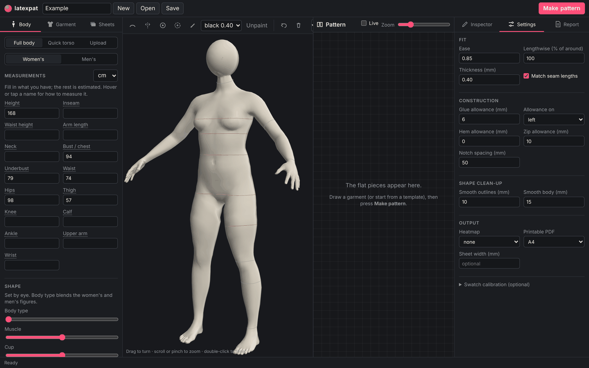

- **Top bar:** the project name, **New**, **Open**, **Save**, and **Make pattern**.
- **Left panel:** **Body** (measurements and shape), **Garment** (templates and the curves you draw) and **Sheets** (the latex you will cut from).
- **Middle:** the 3D view with the drawing tools above it, and the flat **Pattern** pieces beside it.
- **Right panel:** the **Inspector** for the selected curve, the pattern **Settings**, and the **Report**.

In the 3D view, drag to turn the body, scroll (or pinch) to zoom, and
double-click (or double-tap) to reset the view.

Click the project name (top left) and call it *Sleeveless top*.

## 1. The body

Open the **Body** tab and keep **Full body** selected. Pick **Women's** or
**Men's**; the rest of this tutorial uses the women's figure.

Fill in the measurements you have, in cm (or switch the units to mm or
inches). Hover over, or tap, a measurement's name for how to take it. For a
top, these matter most:
- **Height**
- **Bust / chest**, **Underbust** and **Waist**
- **Hips**: the top ends at the hips.

Leave the rest empty and the app estimates them from the others. Then press
**Update body**. The orange lines on the body are where each measurement you
gave is taken; grey lines are estimated ones. If a combination can't be
reached, a warning under the button says by how much.

The **Shape** sliders (body type, muscle, cup, belly, buttocks) are set by
eye, since a tape can't tell them apart. The body is shown as a dressmaker's
mannequin; tick **Realistic detail** for the full model. Neither changes the
measurements.

## 2. Plan the garment

A garment is drawn on the body with two kinds of curve:
- **Edges** (yellow) are where the latex ends: necklines, armholes, hems. Each is a closed loop.
- **Seams** (blue) are where two pieces are glued together. They split the garment into pieces that can lie flat. Each seam must end on an edge or on another seam (within 2 cm).

Then one click **inside** the garment tells the app which side of the edges
is latex.

For this top:

| Curve | Kind | Where |
|---|---|---|
| neckline | edge | around the base of the neck, scooping down at the front |
| armhole | edge | around the right armhole, mirrored to the left |
| hem | edge | around the hips |
| shoulder | seam | along the top of the shoulder, from the neckline to the armhole, mirrored |
| side | seam | down the side, from the bottom of the armhole to the hem, mirrored |

Garments are **symmetric** unless you tick **Asymmetric design**. A curve with
**Mirror to other side** ticked is drawn once and copied to the other side.
The matching pieces come out as exact mirror images.

Open the **Garment** tab. The curves you draw are listed there; click one to
select it and edit it in the **Inspector**.

## 3. The neckline

Click **Edge** (the first tool above the 3D view), then click points on the
body, all the way around the neck:
- **Front:** start at the centre front, about 9 cm below the hollow of the throat.
- **Sides:** curve up to the top of the shoulder, just beside the neck.
- **Back:** carry on round the back of the neck, just below the knobbly vertebra at its base, and down the other side to where you started.

About ten points are enough. The curve passes smoothly through them and
closes by itself (it's an edge, so **Closed loop** is ticked). Turn the body
as you go to reach the back.

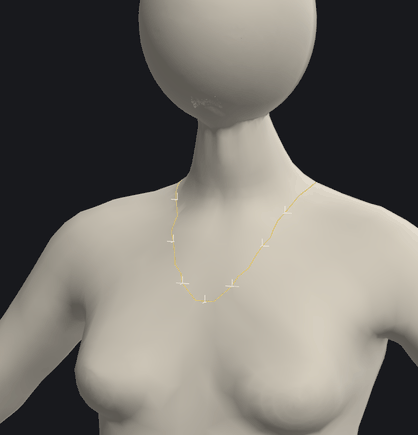

In the **Inspector**, set its **Name** to *neckline*.

To fix a point, select the curve and drag the point along the body. **Undo
point** removes the last point you clicked; **Delete** removes the selected
curve.

## 4. The armholes

Click **Edge** again and click around the right armhole:
- start on top of the shoulder, about a hand's width out from the neck;
- go down the front, where the arm meets the chest;
- go under the arm, about 3 cm below the armpit;
- come up the back, where the arm meets the back.

Eight to ten points. Name it *armhole* and tick **Mirror to other side**: the
left armhole appears too.

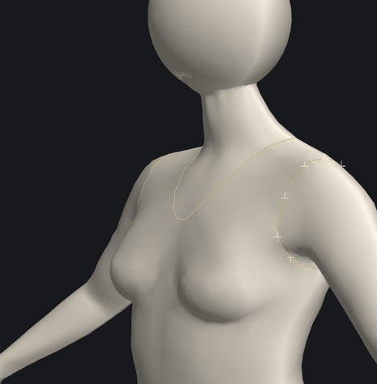

## 5. The hem

One more **Edge**, around the hips at the length you want, about twelve
points all the way round. Name it *hem*.

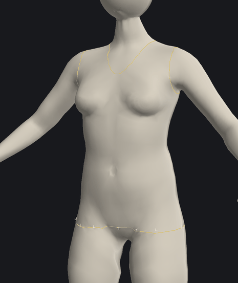

The status under the curve list now says **Pick a point inside the garment**:
the app has the edges but doesn't yet know which side of them is latex.

## 6. The seams

Click **Seam** (the second tool). For the shoulder:
1. Click **on the neckline**, on top of the shoulder.
2. Click **on the armhole**, on top of the shoulder.

Two points are enough. Name it *shoulder* and tick **Mirror to other side**.

Then a second **Seam** down the side of the body:
1. Click **on the armhole**, under the arm.
2. Click a few points down the side.
3. Finish **on the hem**.

Name it *side* and mirror it.

A seam's ends snap onto an edge or another seam within 2 cm, so start and
finish each one right on the yellow line.

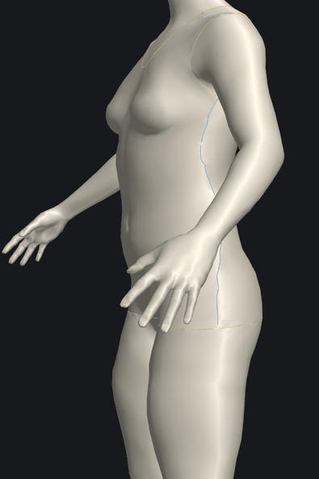

## 7. Inside

Click **Inside** (the target tool) and click once on the front of the body,
between the bust and the hem. The latex appears in the colour of its sheet,
and the status reads:

> Ready: the seams cut this garment into 2 flat pieces.

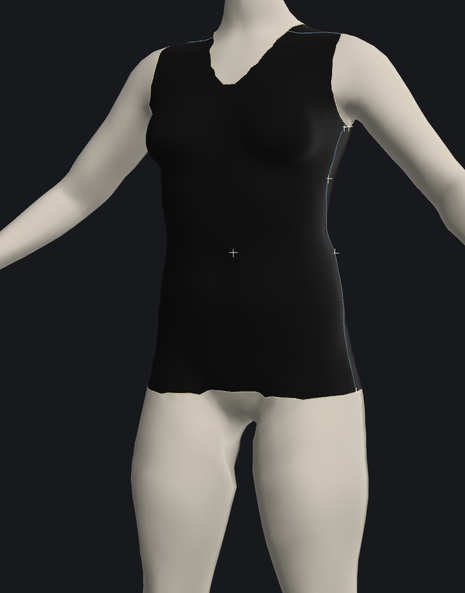

If it says instead that a piece **still wraps around the body**, a seam
doesn't reach its edge. Select the seam and drag its end onto the edge.
Without a joined seam the front and back are one tube, and a tube can't be
laid flat.

## 8. How each edge is finished

Select each edge in the curve list and set its **Finish** in the Inspector:

| Edge | Finish | Width |
|---|---|---|
| neckline | trim strip | 15 mm |
| armhole | trim strip | 15 mm |
| hem | folded hem | 20 mm |

A **trim strip** is a separate strip of latex glued round the edge. It is cut
shorter than the edge (90 % by default, the **Trim length**) so it pulls the
edge snugly against the body. A **folded hem** turns the given width under and
glues it. **Raw** leaves the edge as cut, which is fine for latex since it
doesn't fray.

Seams default to **glued (lap)**: one piece's allowance glues under the
other's edge. Choose **zip** on a seam for a zip instead.

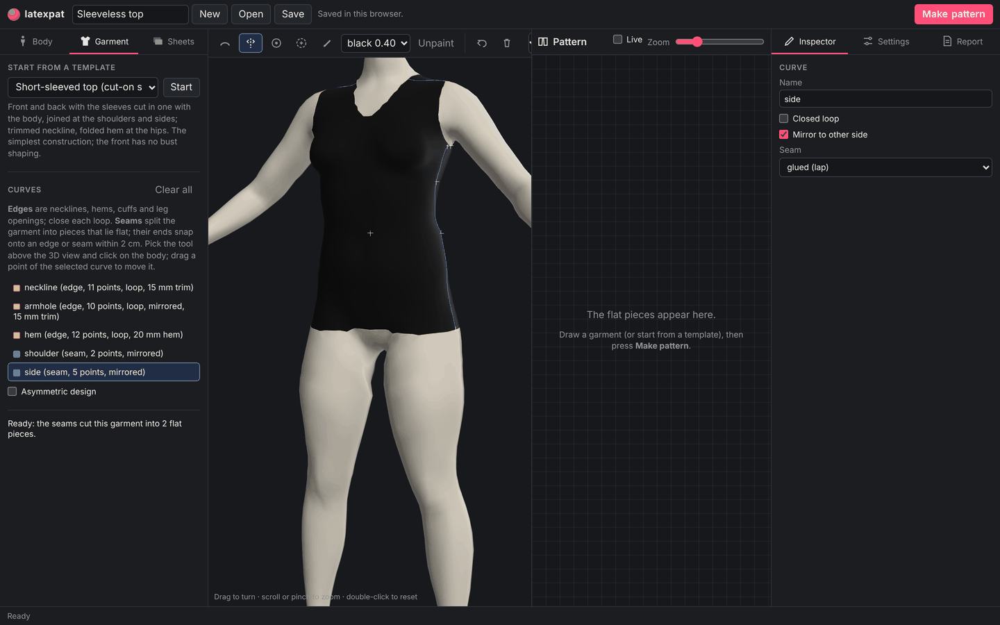

## 9. Pattern settings

Open **Settings** in the right panel.

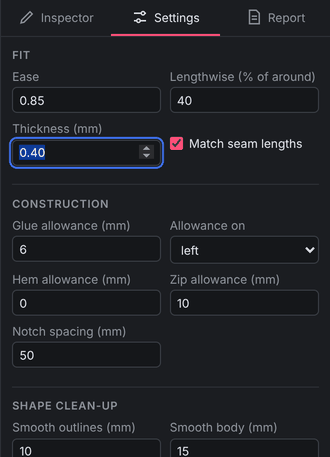

- **Ease** (0.85): the pattern is 85 % of the body's size, so the latex stretches about 18 % when worn. Higher is looser, lower is tighter.
- **Lengthwise (% of around)**: latex is usually reduced less along the body than around it. Set **40** so the top doesn't ride up.
- **Thickness** (0.40 mm): used for the pressure map. Your sheets can also carry their own thickness and ease, in the **Sheets** tab.
- **Glue allowance** (6 mm): the lap added to one side of each seam.
- **Notch spacing** (50 mm): matching marks along each seam.
- **Printable PDF** (A4 or Letter): every piece at full size, tiled over pages.

Settings are not stored in the project file yet, so note any you change.

## 10. Make the pattern

Press **Make pattern** (top right). It takes a few seconds.

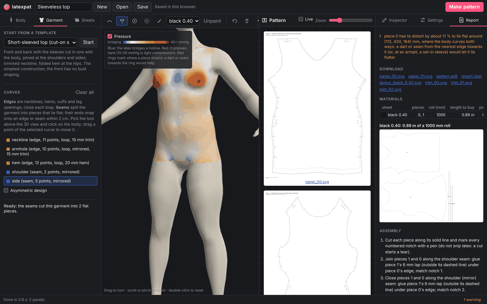

The **Pattern** view shows the pieces on a cutting mat (use **Zoom** to
resize them):
- **Front (piece 0):** the deep scoop.
- **Back (piece 1):** the shallower neckline.

On each piece:
- the solid line is the cut line;
- the dashed line is the seam line, where a piece carries a glue allowance;
- the numbered ticks are notches: each number is on two pieces, at the same point of the body.

Tick **Live** to remake the pattern after every change to the curves.

The **Report** tab lists everything about the result.

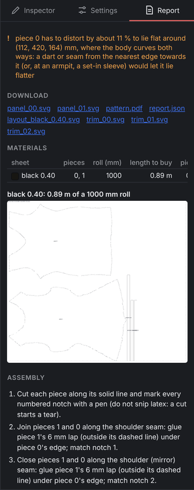

- **Warnings**, also counted in the status bar.
- **Downloads:**
  - one SVG per piece;
  - `pattern.pdf` to print;
  - the layout on your roll;
  - one SVG per trim strip;
  - `report.json` with every number.
- **Materials:** how much of each sheet to buy. Here 0.89 m of a 1000 mm roll.
- **Assembly:** the order to glue it together (see step 13).
- **Pieces:** a row per piece. The columns:
  - **min σ / max σ:** the range of stretch;
  - **95 % under:** the stretch that 95 % of the piece's area stays under, here about 1.28 for the front and 1.22 for the back;
  - **slack:** area that won't stretch, which tends to wrinkle;
  - **mmHg:** how hard the piece presses on the body;
  - **bridging:** area that spans a hollow without touching;
  - **cut size.**
- **Seams:** each seam's length on the body and on both pieces. Seam matching evens the two sides out, so they glue together without puckering.

## 11. The pressure map, and the bust

After Make pattern, the garment on the body is coloured by pressure. Blue is
where the latex bridges a hollow (between the breasts, the small of the back),
white is light, and orange to red presses harder; 15–20 mmHg is light
compression. Untick **Pressure** to see the latex colour again.

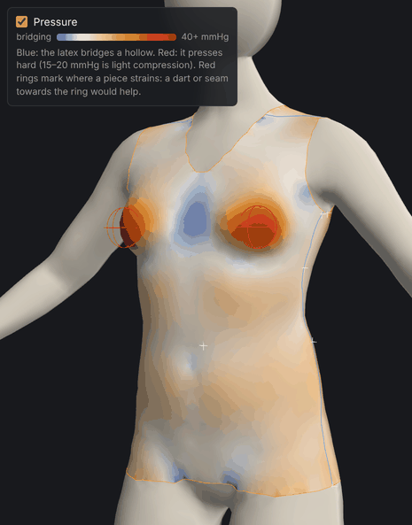

The red rings at the bust match the one warning in the report:

> piece 0 has to distort by about 11 % to lie flat around … where the body
> curves both ways: a dart or seam from the nearest edge towards it … would
> let it lie flatter

A flat sheet can only follow a surface that curves one way at a time, and a
bust curves both ways. This top has no shaping there, so the front stretches
more over the bust. In latex that is often fine (it's why latex tops can be so
simple). If you want a smoother fit:
- **Princess seams:** draw seams from the shoulder or armhole down over the bust to the hem (as in the **Princess-seam top** template). The front becomes three pieces that curve over the bust.
- **Ease zone:** use **Zone** to click on the bust and give it a looser ease.

## 12. Check it in a pose

Patterns are always drafted standing, but you move in them. Pick **Arms up**
in the **Pose** menu (top right of the 3D view) and press **Make pattern**
again.

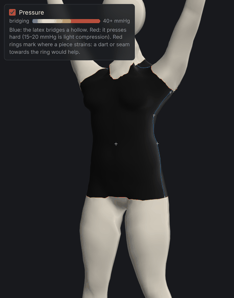

The **Pieces** table gains two columns: the stretch and pressure in that pose.
With arms up, the front's 95 % stretch goes from 1.28 to about 1.53 and the
back's from 1.22 to about 1.90, mostly around the armholes. Near the armpits
the posed figures run high, because the model's skin can't slide over the
joint the way real skin does. If they look too high for your taste:
- lower the armholes;
- loosen the ease;
- move to set-in sleeves.

Set the pose back to **Standing** when you're done.

## 13. Save, print and make it

**Save** downloads the project as `Sleeveless_top.latexpat.json`, holding the
body, the garment and the sheets. **Open** brings it back. The app also keeps
your work in the browser between visits.

To print:
1. Download `pattern.pdf` from the Report.
2. Print it at **100 %** (no "fit to page").
3. Measure the 50 mm check square.
4. Trim the pages at the corner marks and tape them together by their row/column labels.

You can also print the SVGs, which have a 50 mm scale bar.

The **Assembly** list for this top reads:

1. Cut each piece along its solid line and mark every numbered notch with a pen (do not snip latex: a cut starts a tear).
2. Join pieces 1 and 0 along the shoulder seam: glue piece 1's 6 mm lap (outside its dashed line) under piece 0's edge; match notch 1.
3. Close pieces 1 and 0 along the shoulder (mirror) seam the same way; match notch 2.
4. Close pieces 0 and 1 along the side seam: glue piece 0's 6 mm lap under piece 1's edge; match notches 3–10.
5. Close the other side seam the same way; match notches 11–18.
6. Hem the hem edge: fold the 20 mm allowance to the inside along the dashed line and glue it.
7. Finish the neckline with its trim strip, 15 × 487 mm. It is 10 % shorter than the edge, so stretch it evenly as you glue it on.
8. Finish each armhole with its trim strip, 15 × 344 mm, the same way.

The trim strips are drawn in `trim_NN.svg` (and in the PDF) with quarter
marks: match those to the quarters of the edge so the stretch is even all
round. Your lengths will differ with your measurements.

## Where next

- **Templates:** **Start from a template** in the Garment tab gives tops with set-in, raglan or cut-on sleeves, a princess-seam top, leggings, catsuits and a waist cincher. Every curve stays editable.
- **More sheets:** add sheets in **Sheets**, then use **Paint** to make a piece from another colour or thickness. Each sheet gets its own layout and length to buy.
- **Your own ease:** to set the ease from stretch tests of your own latex, see *Swatch calibration* in the [README](../README.md).
