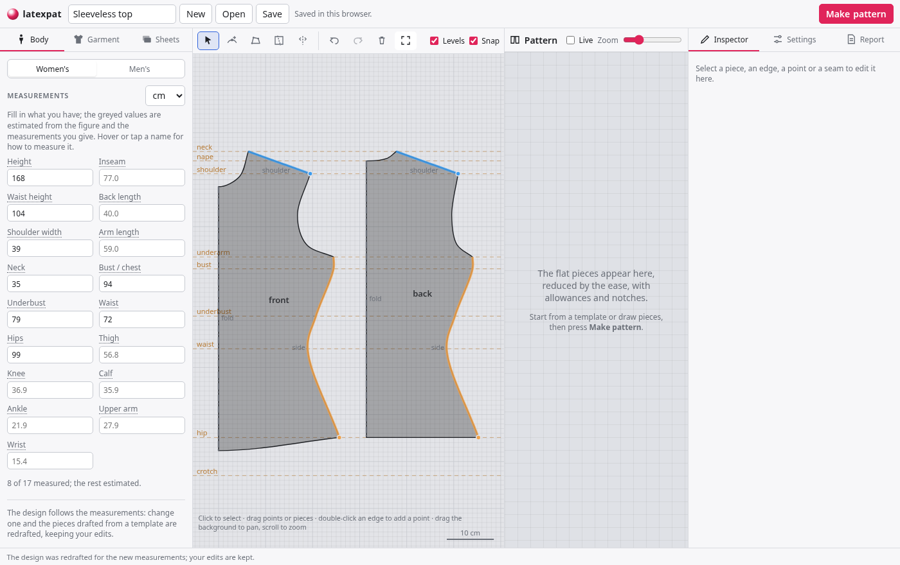
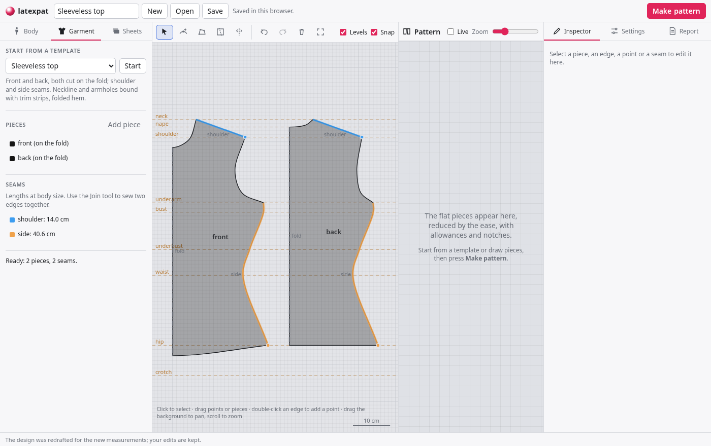
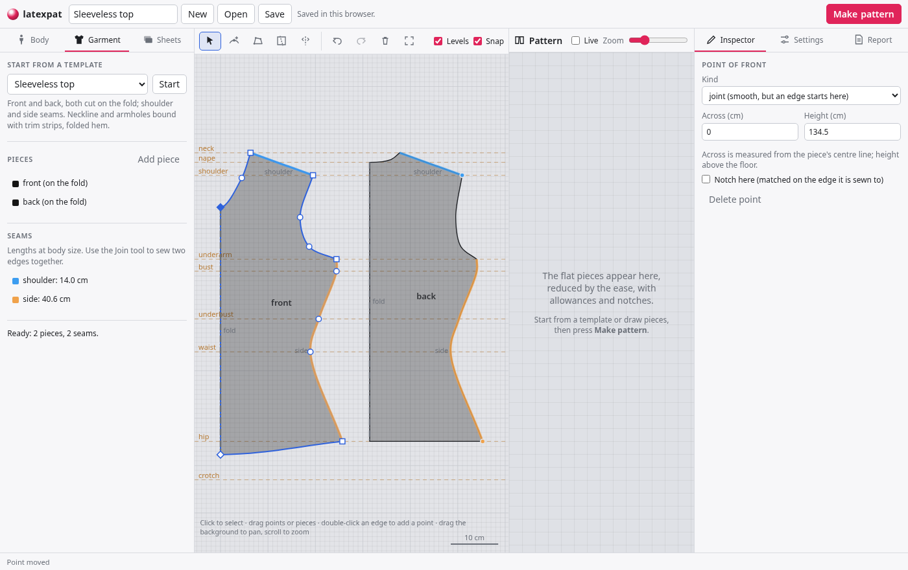
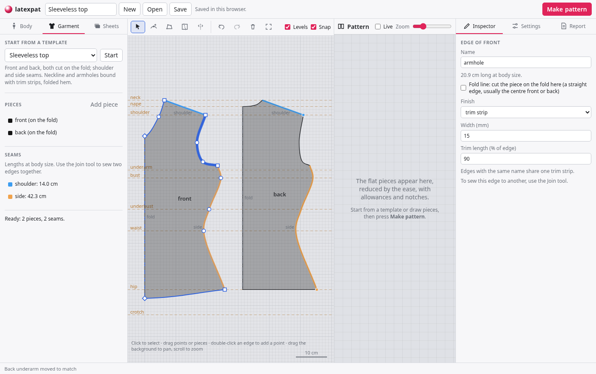
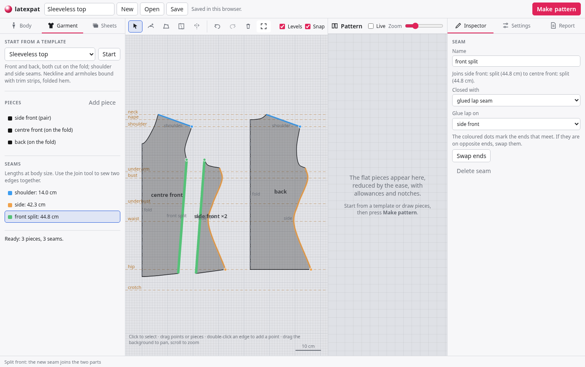
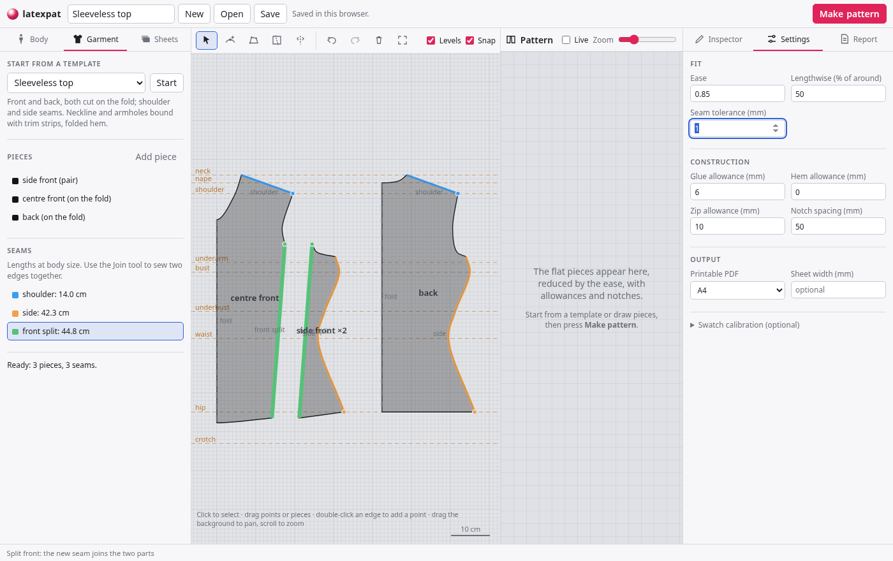
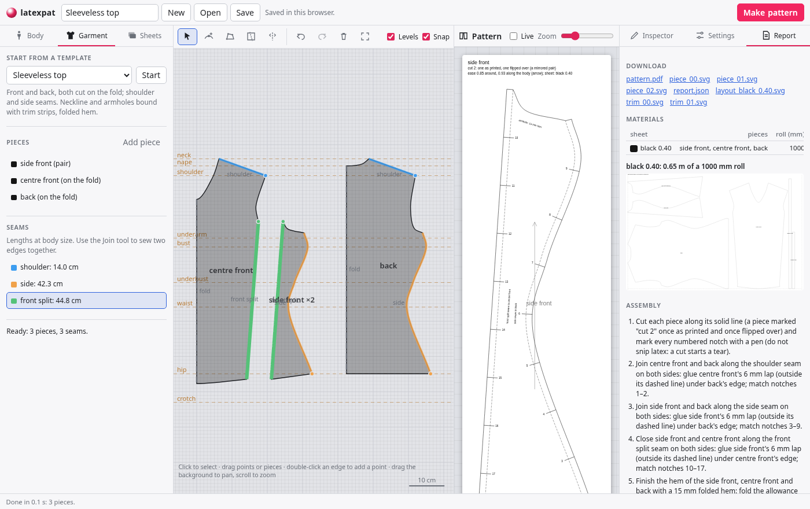
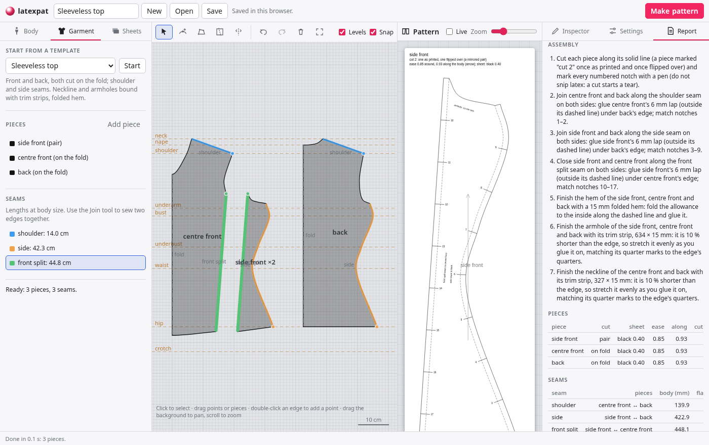

# Tutorial: a sleeveless top, from measurements to the printed pattern

This walks through the whole of latexpat with one garment: a close-fitting
sleeveless top with a scooped neckline and princess lines. It takes about
ten minutes. Open the app (https://manfromth3m0on.github.io/pattener/, or
locally as in the [README](../README.md#web-app)); the finished project is
[`tutorial/sleeveless-top.latexpat.json`](tutorial/sleeveless-top.latexpat.json)
if you want to open it alongside (**Open** in the top bar).

## 1. Measurements

On the **Body** tab pick **Women's** or **Men's** and fill in what you
have. Hover over (or tap) a name for how to take it. You don't need all
seventeen: the rest are estimated from the figure and the measurements you
give, and shown greyed in their fields. For a top, the height, waist height,
bust, underbust, waist, hips, neck and shoulder width matter most.

The dashed lines across the design are the body's levels (neck, shoulder,
underarm, bust, waist, hip…) worked out from your measurements. Pieces are
drawn at body size, at their real height above the floor, so the levels run
across them where they fall on the body.

## 2. Start from a template

The app opens with the **Sleeveless top** template drafted for the typical
figure; once you enter measurements, it is redrafted for them straight away.
On the **Garment** tab you can start another template instead.

The top is the right half of the garment: a front and a back, each **cut on
the fold** at the centre (the dash-dot line). Coloured edges are seams, with
their lengths listed on the left: the shoulder seams and the side seams.
The dots mark the ends of a seam that meet. The neckline and armholes are
open edges, finished with trim strips; the hem is folded.

## 3. Scoop the neckline

Click a piece to select it: its points appear. Drag the point at the
centre front of the neckline down. With **Snap** on, points move by whole
millimetres and catch on the levels. The point is a *joint* (a diamond): the
neckline stays square to the fold, so the unfolded neckline has no point at
the centre.

The **Inspector** on the right shows what is selected: here the point's
kind and its position. *Corner* points (squares) make a sharp corner and
start a new edge; *smooth* points (circles) are just for shaping the curve:
double-click an edge to add one, or use the **Point** tool. Everything can
be undone with **Ctrl+Z**.

## 4. Raise the armholes

Drag the underarm points of the front and back up and in a little for a
higher, sportier armhole. Do the same on both pieces so the side seams
still match: the seam list shows a seam's two lengths if they differ.
Click an edge to see its length and finish:

Open edges can be left raw (latex doesn't fray), hemmed, or bound with a
trim strip cut 10 % shorter than the edge so it hugs the body. Edges with
the same name share one strip: the front and back armholes make one armhole
strip.

## 5. Add princess lines

Pick the **Split** tool and click two points on the front's outline: one on
the armhole, one on the hem. The front is cut along the line into a centre
front and a side front, joined by a new seam. Since the side front no longer
reaches the fold, it is cut as a mirrored pair (×2). Drag the pieces apart
and rename them in the Inspector.

The new seam is straight; add smooth points to it with the Point tool and
drag them to curve it over the bust (curve both sides alike, and check the
seam's two lengths in the Inspector). The **Join** tool sews any two edges
together in the same way, and **Piece** draws a new piece from scratch.

## 6. Settings

On the **Settings** tab, **Ease** is how much smaller the pattern is than
the body around it: 0.85 stretches by about 18 % when worn. Latex is usually
reduced less along the body than around it: set **Lengthwise** to 30–50 %.
Here it is 50 %. "Along" is the way the arrow on each piece points: the
templates are drawn upright, so their arrows point up the page. If you draw
a piece turned (a strap lying on its side, say), drag the round handle at
the head of its arrow until it points up the body. Glue, hem and zip
allowances and the notch spacing are set here too, and the paper size of
the printable PDF.

Each latex sheet (on the **Sheets** tab) can have its own ease, or come
from a swatch calibration of your own stretch tests; select a piece to cut
it from another sheet.

## 7. Make the pattern

Press **Make pattern**. The pieces appear on the right as they will be
cut: reduced by the ease, unfolded, with glue laps (dashed line inside the
cut line), numbered notches matched across each seam, an arrow up the body,
and labels saying what each edge joins.

The **Report** has the downloads (`pattern.pdf`, one SVG per piece, trim
strips, the layout on each sheet), the length of each roll to buy and its
cost, and the assembly guide:

## 8. Print and make it

Print `pattern.pdf` at 100 % (actual size) and check the 50 mm square on
the first page. Trim each page on its corner marks, tape the pages
together, and cut the pieces out. A piece marked "cut 2" is cut once as
printed and once flipped over.

Then follow the assembly guide: mark the notches with a pen (snipping
latex starts tears), glue the shoulders, then the princess and side seams,
fold and glue the hem, and stretch the trim strips evenly round the
neckline and armholes, matching their quarter marks to the edges' quarters.

## Changing size later

Change any measurement and the design is redrafted for it, keeping your
edits: the scooped neckline stays 4 cm lower than the template's, and the
princess line moves with the points around it. Save the project with
**Save**; it is also kept in the browser.
